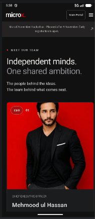
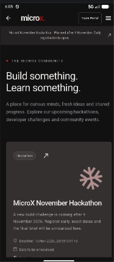
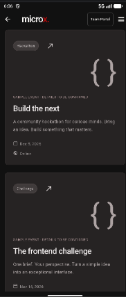

# MicroX — Team & Community App

Flutter implementation of the MicroX website's Team and Community pages.

Developed by Malaeka Jannat as part of the MicroX internship.

## Features

- Team member profiles with images
- Community event cards
- Navigation between Team and Community screens
- External links for events, careers, contact and Team Portal
- Reusable banners, cards and footer widgets
- Portrait and landscape layouts

## Screenshots

### Team

### Community

## Run the app

flutter pub get
flutter run

## Checks

- Flutter analyzer passed.
- Team screen widget test passed.
- Navigation and event links manually checked on Android emulator.

## Android APK

The ARM64 APK is provided separately with the submission.

To build APKs:
flutter build apk --release --split-per-abi

## Scope

This project implements the Team and Community screens.
Other website sections open externally in the browser.